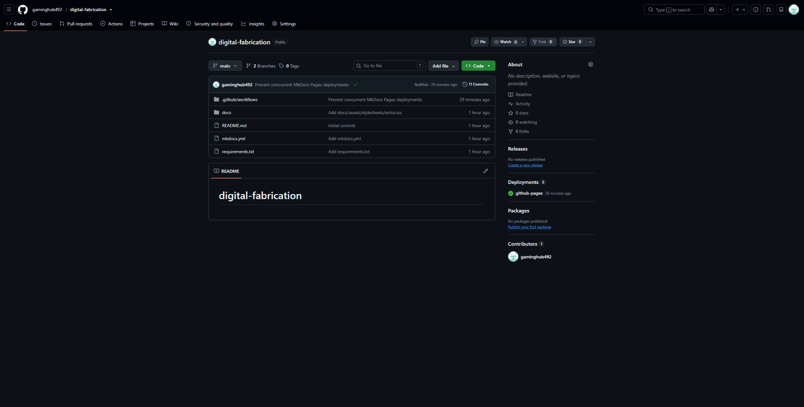
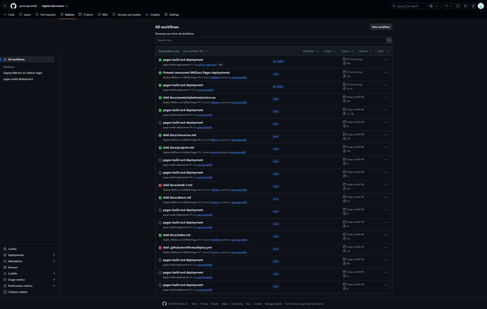
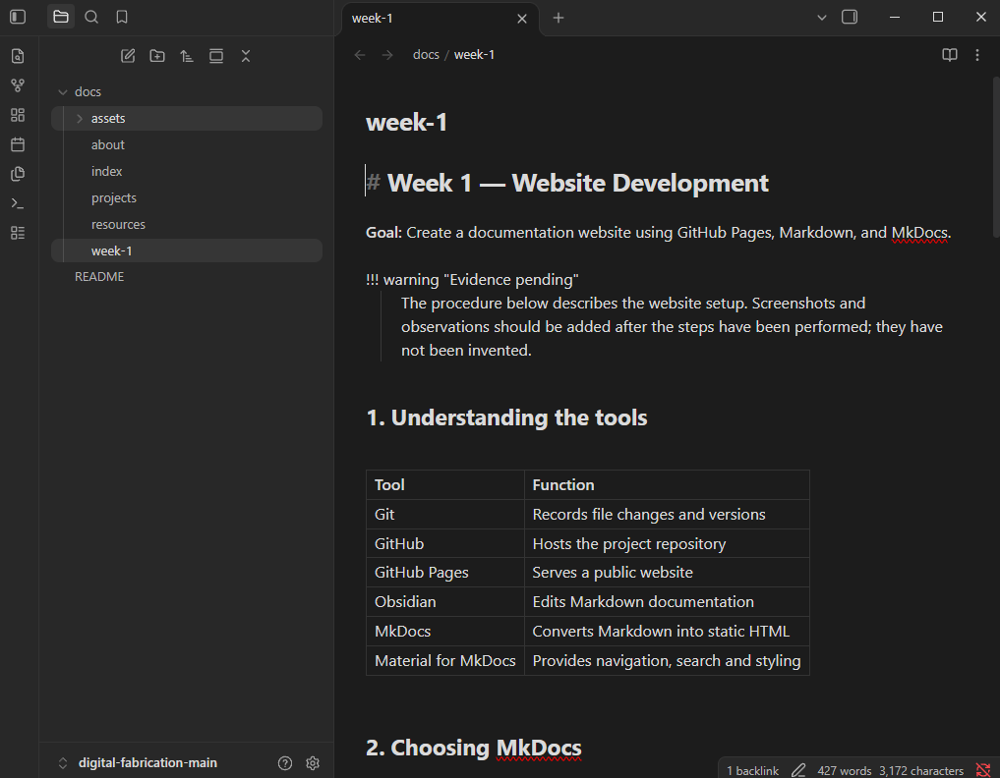
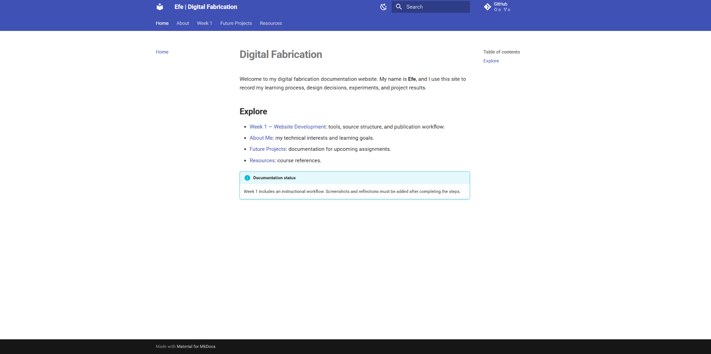

# Week 1 — Website Development

**Goal:** Create a documentation website using GitHub Pages, Markdown, and MkDocs.

!!! success "Website published and documented"
    The GitHub repository, successful deployment, Obsidian setup, and published website are documented with screenshots below. Local Markdown editing and synchronization through Git remain optional next steps to practise.

## 1. Understanding the tools

| Tool | Function |
| --- | --- |
| Git | Records file changes and versions |
| GitHub | Hosts the project repository |
| GitHub Pages | Serves a public website |
| Obsidian | Edits Markdown documentation |
| MkDocs | Converts Markdown into static HTML |
| Material for MkDocs | Provides navigation, search and styling |

## 2. Choosing MkDocs

MkDocs suits documentation websites because it uses readable Markdown files. The Material theme supplies responsive navigation, search, and light/dark modes. The source is separate from the published HTML, which is generated automatically.

## 3. Repository structure

```text
digital-fabrication/
├── .github/workflows/deploy.yml
├── docs/
│   ├── index.md
│   ├── about.md
│   ├── week-1.md
│   ├── projects.md
│   └── resources.md
├── mkdocs.yml
└── requirements.txt
```

The `docs` folder contains Markdown documents. `mkdocs.yml` defines the website theme and navigation. The GitHub Actions workflow builds the site.

## 4. Publication procedure

1. Create a public GitHub repository named `digital-fabrication`.
2. Add the MkDocs configuration, Markdown pages, and GitHub Actions workflow.
3. Open **Actions** and check whether **Deploy MkDocs to GitHub Pages** completes successfully.
4. In **Settings → Pages**, select **Deploy from a branch**, `gh-pages`, and `/ (root)`.
5. Visit [the final website](https://gaminghub492.github.io/digital-fabrication/).

```text
Markdown → GitHub commit → GitHub Actions → MkDocs build
→ gh-pages branch → published website
```

## 5. Using Obsidian

Install [Obsidian](https://obsidian.md/), download the repository, and open the `docs` directory as a vault. Edit a Markdown document and save it. Commit and push the changes to update the site.

## 6. Optional local preview

With Python installed, run from the repository directory:

```powershell
python -m pip install -r requirements.txt
python -m mkdocs serve
```

Open `http://127.0.0.1:8000/`.

Other useful Git commands:

```powershell
git status
git add .
git commit -m "Update documentation"
git push
```

## 7. Evidence from the website setup

The screenshots below show the repository, successful publishing workflow, Obsidian editor, and completed website. All four images are stored in this repository.

### GitHub repository




The repository named `gaminghub492/digital-fabrication` contains the Markdown documentation in `docs/`, a `mkdocs.yml` configuration file, the package requirements, and the automated workflow under `.github/workflows/`. This separation keeps editable source files distinct from the generated website.

### GitHub Actions and deployment




The Actions page shows the **Prevent concurrent MkDocs Pages deployments** workflow completing successfully, alongside the GitHub Pages publishing workflow. Each update to the main branch can trigger a rebuild, so changes to the documentation can appear on the public website without manually uploading generated HTML.

### Editing documentation using Obsidian




I installed Obsidian, downloaded and extracted the documentation project, and opened it as a vault. The editor displays `week-1.md` alongside the other Markdown pages. Markdown headings, tables, and text can be edited directly. Because this is an extracted ZIP rather than a Git clone, changes saved locally do not automatically update GitHub.

### Published MkDocs website




The public site at [Efe | Digital Fabrication](https://gaminghub492.github.io/digital-fabrication/) displays the Material for MkDocs theme and navigation for Home, About, Week 1, Future Projects, and Resources. This confirms the generated website is publicly viewable.

### Problem encountered and solution

During initial setup, the website source files were committed separately in quick succession. This triggered overlapping GitHub Actions runs, several of which attempted to publish to the `gh-pages` branch at nearly the same time. The error log showed a rejected push to `gh-pages`, because its branch reference had changed since a deployment started. In other words, the website build itself succeeded, but competing deployments interfered with publishing.

The workflow was updated to use a **concurrency group** that prevents simultaneous publishing jobs, and to retrieve full Git history. A subsequent run completed successfully, and the MkDocs website became accessible.

**What I learned:** Git tracks versions of source files; GitHub stores those files online; Obsidian edits Markdown; MkDocs generates a website from Markdown; and GitHub Actions with GitHub Pages publishes the resulting site. The deployment problem demonstrated why automated publishing jobs should not overwrite the same branch concurrently.

## 8. Completion checklist and reflection

- [x] Created the public GitHub repository.
- [x] Uploaded the website source and documented its structure.
- [x] Confirmed successful deployment and recorded a screenshot.
- [x] Opened and photographed the published website.
- [x] Installed Obsidian and opened the downloaded Markdown documentation.
- [x] Documented the deployment error and its solution.
- [x] Added the four evidence screenshots to the Week 1 documentation.
- [ ] Practise making and saving a new change in Obsidian, then upload that change to GitHub. This is a future practice step, not a claim of completed work.

### Reflection

**What worked?** The source files were organized in GitHub, MkDocs generated the documentation website, and GitHub Pages made it available publicly. A successful deployment and screenshots of the finished site confirmed the outcome.

**What problems occurred?** Several overlapping GitHub Actions runs attempted to update the same `gh-pages` branch, leading to rejected pushes. Setting a concurrency group for publishing resolved the conflict.

**What did I learn?** Markdown provides a simple format for recording technical work, while MkDocs transforms it into a navigable website. GitHub stores the source and its revision history, and GitHub Actions automates publication. Obsidian can be used to edit the local Markdown files, but a downloaded ZIP does not automatically synchronize changes to GitHub.

See [Resources](resources.md) for the course materials.
